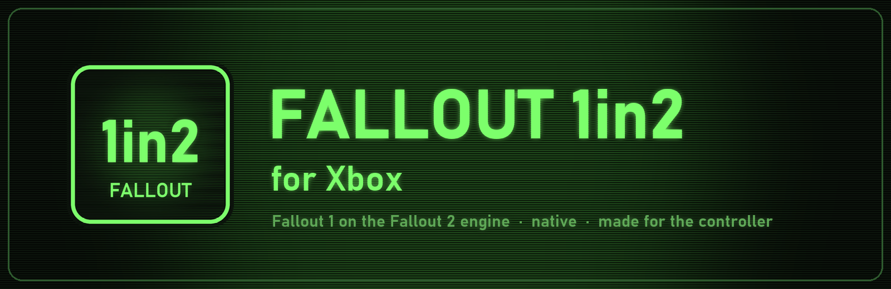
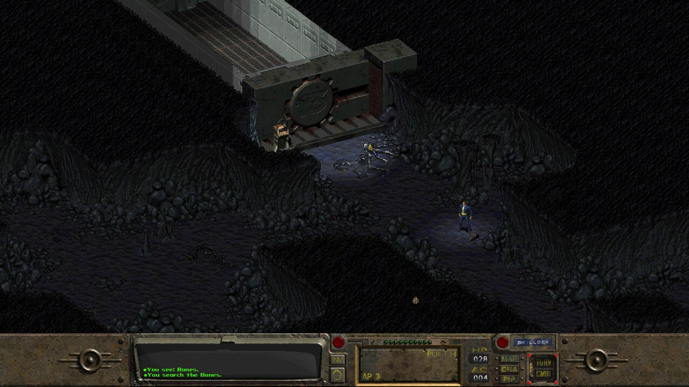
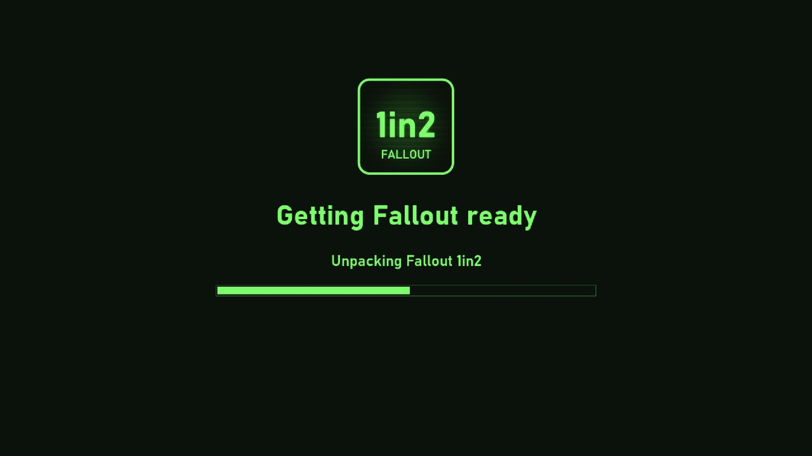
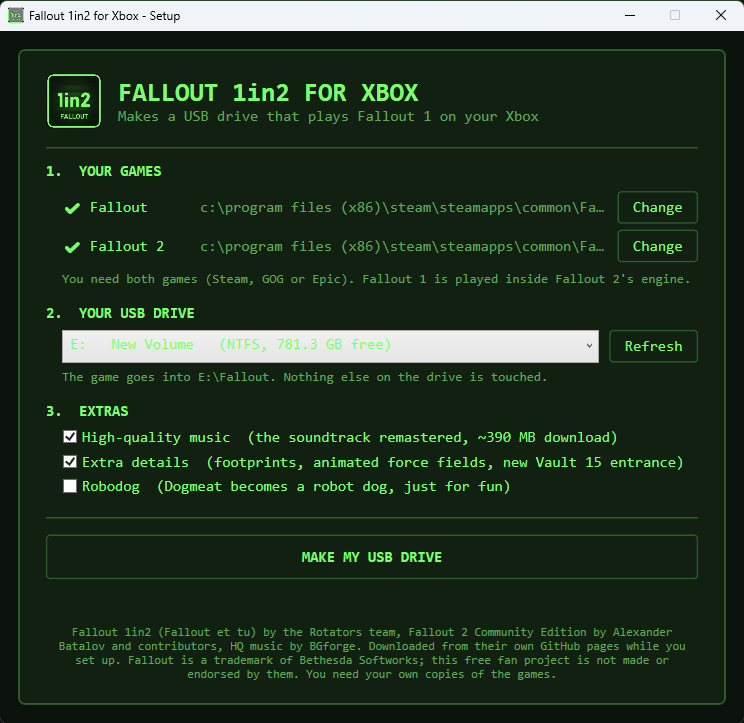

  

<h3 align="center">The original Fallout, rebuilt for the TV and the controller.</h3>

  <b>Fallout 1 played inside the Fallout 2 engine, running natively on Xbox Series X|S in Dev Mode.</b> 
  No PC emulation and no mouse needed: pick up the controller and walk out of Vault 13.

<!-- gv-buttons:start -->

  
  &nbsp;
  
  &nbsp;
  
  &nbsp;
  

<!-- gv-buttons:end -->

  
  
  
  
  
  

  

<table align="center">
  <tr>
    <td align="center" width="33%"><h3>📁 1. Copy</h3>Put your own <b>Fallout</b> and <b>Fallout 2</b> folders on a USB drive.</td>
    <td align="center" width="33%"><h3>🔌 2. Plug in</h3>Start the app. It finds both games and builds Fallout 1in2 by itself.</td>
    <td align="center" width="33%"><h3>▶️ 3. Play</h3>RT does the obvious thing. B cancels. Start saves.</td>
  </tr>
</table>

  
  

Left: the first start on the console sets everything up. Right: the optional PC tool does the same on a Windows PC.

---

**Fallout 1in2** by the Rotators team brings the whole of Fallout 1 into the Fallout 2 engine: better
interface, party orders, fixed bugs, and the full original story. This project runs it on **Fallout 2
Community Edition**, ported to the Xbox as a native app with full controller play, Xbox sound and
Direct3D graphics.

> [!WARNING]
> **This is a beta.** The whole game is playable, but the controller feel is still being tuned. If something
> goes wrong, please open an [issue](https://github.com/skitzellez/Fallout1in2-Xbox/issues) and attach the log
> (see [Reporting a problem](#-reporting-a-problem)).

> [!IMPORTANT]
> **No game files are included.** You need your own copies of **Fallout** and **Fallout 2** (Steam, GOG or Epic).
> The Fallout 1in2 mod and the HQ music are downloaded from their authors' own pages when you set up.

## ✨ Features

| | |
|---|---|
| 🎮 **Made for the controller** | A smart cursor: over a person or door it becomes "talk / use", over an enemy in combat it becomes the crosshair. LB / RB jump straight to the next thing on screen. |
| 📦 **Native Xbox app** | No PC emulator in between. Starts in seconds, runs at full speed. |
| 🧰 **Sets itself up** | First start finds your games on the USB drive, fetches Fallout 1in2 and builds the game folder. No PC needed. |
| 🎵 **HQ music** | The remastered soundtrack is added when the console is online. |
| ✨ **Extra details** | Footprints in the sand, animated force fields and a new Vault 15 entrance. |
| 💾 **Saves on your drive** | Saves live next to the game on the USB drive, named after the town you saved in. |

## 📋 Requirements

- An **Xbox Series X or Series S** in **Developer Mode** (the free Xbox Dev Mode app from the Microsoft Store).
- Your own **Fallout** and **Fallout 2** (Steam, GOG or Epic).
- A **USB drive** (FAT32, exFAT or NTFS) with about 3 GB free.
- Internet on the console for the first start, **or** a Windows PC to run the setup tool.

## 🚀 Installation

1. On the console, open **Dev Home** and turn on the **Device Portal** (Remote Access Settings).
2. Download **Fallout1in2_x64.appx** from [Releases](https://github.com/skitzellez/Fallout1in2-Xbox/releases/latest)
   and install it from the Device Portal (**Add** under My games & apps).
3. In **Dev Home**, highlight the app, press **Menu → View details**, and set **App type** to **Game**.
4. Get the games onto a USB drive, one of two ways:
   - **The easy way:** copy your **Fallout** and **Fallout 2** game folders to the top of the USB drive
     (for example `E:\Fallout` and `E:\Fallout 2`). The console does the rest on first start.
   - **With a Windows PC:** download **Fallout1in2-Setup.zip**, unzip it and run **Fallout 1in2 Setup.exe**.
     It finds your games, lets you pick the drive and extras, and builds a ready-to-play `Fallout` folder.
5. Plug the drive into the Xbox and start **Fallout 1in2**.

## 🎮 Controls

| Button | Action |
|---|---|
| Left stick | Move the cursor (it slows down over things, so it is easy to stop on them) |
| **RT** or **A** | Action: walk, talk, use, attack. The cursor picks the right one by itself |
| **B** | Cancel / close. In combat: cancel aiming, or **end your turn** |
| X | Change cursor mode by hand (walk, use, look, attack) |
| LB / RB | Jump the cursor to the previous / next person, item or door (enemies only in combat) |
| LT | Skilldex |
| Y | Inventory |
| Right stick | Scroll the map |
| Click right stick | Centre the view on your character |
| D-pad up / down | Character sheet / world map |
| D-pad left / right | Swap hands / weapon mode (single, burst, aimed) |
| View | Pip-Boy |
| Start | Options: save, load, settings, quit |
| Click left stick | Quick save |

## 🐞 Reporting a problem

The app keeps a log in its own folder. Open the **Device Portal → File explorer → LocalState → Skitzelles →
Fallout1in2** and attach `fallout_xbox_log.txt` to a new
[issue](https://github.com/skitzellez/Fallout1in2-Xbox/issues), with a few words about what happened.

## 🛠️ Building from source

The Xbox changes live on this repo's `xbox` branch and are marked `FALLOUT_XBOX` / "Xbox port" in the source.
Build scripts are in [`xbox/`](xbox): `build_sdl2compat.sh`, `build_fallout.sh` and `package.sh <version>`
(MSYS2 UCRT64, the Xbox SDL3 build, and Windows SDK signing tools). The PC setup tool is in
[`xbox/setup`](xbox/setup) (`dotnet build -c Release`).

<!-- gv-family:start -->
## 🎮 The Game Vault family

Game Vault is one launcher plus emulators built to work with it. **Install [Game Vault](https://github.com/skitzellez/xbox-game-vault) and it sets these up for you**; press **RT** in Game Vault to update them all.

**Apps**

| Project | What it is | Runs on |
|---|---|---|
| [Game Vault](https://github.com/skitzellez/xbox-game-vault) | The launcher: plug in a USB drive, pick a game, play. Sets up everything below by itself. | Xbox Series X&#124;S |
| [Game Vault for Android](https://github.com/skitzellez/game-vault-android) | The same game library for phones, tablets and Android TV (beta). | Android |
| [Game Vault for iPhone](https://github.com/skitzellez/game-vault-ios) | The Game Vault look on iPhone (early test). | iPhone |

**Emulators built for Game Vault**

| Project | What it is | Runs on |
|---|---|---|
| [xemu for Xbox Dev Mode](https://github.com/skitzellez/xemu-uwp) | Original Xbox | Xbox Series X&#124;S |
| [Xenia for Game Vault](https://github.com/skitzellez/Xenia-GameVault) | Xbox 360 | Xbox Series X&#124;S |
| [XBSX2 for Game Vault](https://github.com/skitzellez/XBSX2-GameVault) | PlayStation 2 | Xbox Series X&#124;S |
| [Dolphin for Game Vault](https://github.com/skitzellez/Dolphin-GameVault) | GameCube and Wii | Xbox Series X&#124;S |
| [Game Vault · Wii U (Cemu)](https://github.com/skitzellez/Cemu-GameVault) | Wii U | Xbox Series X&#124;S |
| [RetroArch for Game Vault](https://github.com/skitzellez/RetroArch-GameVault) | PlayStation, Dreamcast, arcade and classic systems | Xbox Series X&#124;S, Android |
| [Game Vault · Flash](https://github.com/skitzellez/Flash-GameVault) | Flash games | Xbox Series X&#124;S |
| [Gambatte for Game Vault](https://github.com/skitzellez/Gambatte-GameVault) | Game Boy link cable in online rooms | Xbox Series X&#124;S, Android |
| [X1 BOX for Game Vault](https://github.com/skitzellez/x1box-gamevault) | Original Xbox | Android |

**Extras**

| Project | What it is | Runs on |
|---|---|---|
| [Free games](https://github.com/skitzellez/game-vault-free-games) | Freeware and shareware for the FREE GAMES tab | Game Vault |
| [**Fallout 1in2 for Xbox**](https://github.com/skitzellez/Fallout1in2-Xbox) 📍 *you are here* | The original Fallout, made for the controller | Xbox Series X&#124;S |
| [Game Vault updates](https://github.com/skitzellez/game-vault-updates) | Update data Game Vault reads when it starts | Game Vault |

**💬 Help, news and bug reports:** the [Game Vault Discord](https://discord.gg/RmhhWgguvw) (or this repo's Issues).
Please don't take problems with these builds to the original emulator teams: they don't make or support them.
<!-- gv-family:end -->

## 🙏 Credits

- **[Fallout 1in2 / Fallout et tu](https://github.com/rotators/Fo1in2)** by the Rotators team: the mod that makes all of this possible.
- **[Fallout 2 Community Edition](https://github.com/fallout2-ce/fallout2-ce)** by Alexander Batalov and contributors: the engine (original README: [README-fallout2-ce.md](README-fallout2-ce.md)).
- **[Fallout 2 HQ music](https://github.com/BGforgeNet/Fallout2-HQ-music)** by BGforge.
- **SDL**, **sdl2-compat**, zlib, LodePNG, stb_vorbis and fpattern (licences in the app's `licenses` folder).
- Xbox port, controller play, setup tool and artwork by **Skitzelles**.

## 📜 Licence

This is a **modified version** of Fallout 2 Community Edition, shared under its
[Sustainable Use License](LICENSE.md): free, for non-commercial use only. The Xbox changes, setup tool and
artwork are © 2026 Skitzelles under the same non-commercial terms.

Fallout is a trademark of Bethesda Softworks LLC; Xbox is a trademark of Microsoft Corporation. This free fan
project is not made, approved or endorsed by Bethesda Softworks, ZeniMax Media, Interplay or Microsoft. They
are named only to say which games it works with and where it runs.
